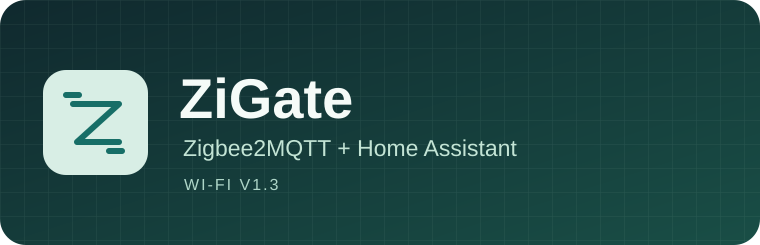
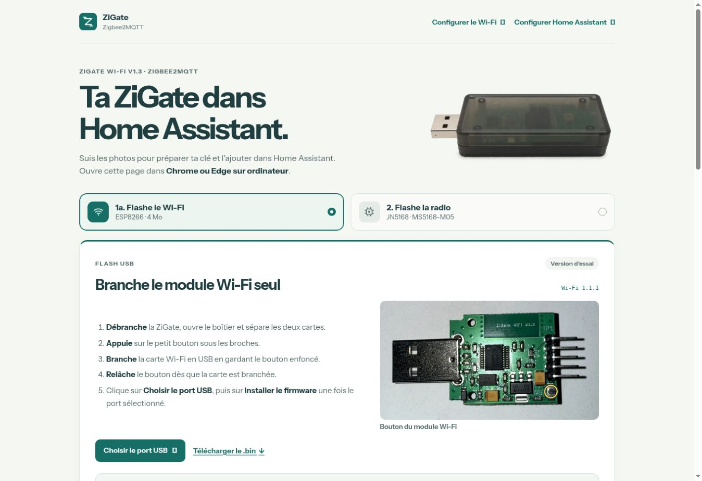
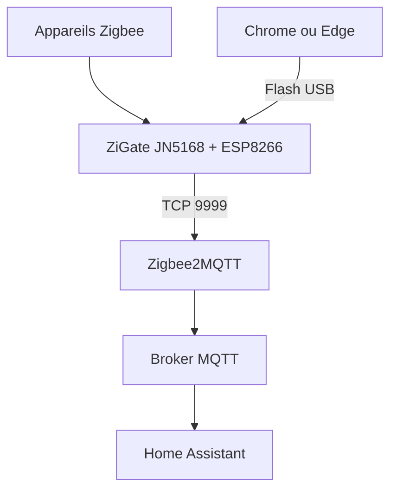

  

  <strong>Réutilise ta ZiGate Wi-Fi v1.3 dans Home Assistant.</strong>
   
  Un guide illustré pour flasher les deux cartes, configurer le Wi-Fi par USB et installer l’application Zigbee2MQTT ZiGate.

  
  
  
  

> [!IMPORTANT]
> Le firmware Wi-Fi 1.1.1 a été compilé pour l’ESP8266. Le changement de Wi-Fi par USB a été testé en simulation et reste à valider sur la carte physique.

## Installation rapide

Tu as besoin d’une **ZiGate Wi-Fi v1.3**, de son adaptateur **USB‑TTL** et d’un ordinateur avec **Chrome ou Edge**.

Ouvre le [guide illustré en français](https://drslid.github.io/zigate-zigbee2mqtt-home-assistant/fr/#flash) et suis les étapes.

| Étape | Geste au branchement |
| --- | --- |
| **1a. Flashe le module Wi-Fi seul** | Appuie sur le petit bouton, branche le module en USB, puis relâche. |
| **1b. Configure le Wi-Fi par USB** | Rebranche le module Wi-Fi seul **sans appuyer**, puis saisis les identifiants de ta box. |
| **2. Flashe la radio Zigbee** | Monte la radio sur l’USB‑TTL du kit débranché. Appuie sur **S2**, branche l’adaptateur, puis relâche. |
| **3. Remonte la ZiGate** | Débranche les cartes, emboîte-les, puis branche la ZiGate **sans appuyer**. |

4. Installe **Zigbee2MQTT ZiGate** dans Home Assistant et saisis l’adresse IP de la clé.
5. Choisis ton [parcours MQTT](https://drslid.github.io/zigate-zigbee2mqtt-home-assistant/#mqtt), démarre **Zigbee2MQTT ZiGate** et appaire ton premier appareil.

**Guides** · [Configurer le Wi-Fi](https://drslid.github.io/zigate-zigbee2mqtt-home-assistant/#wifi) · [Home Assistant](#installation-dans-home-assistant) · [Pilotes USB pour Windows](https://drslid.github.io/zigate-zigbee2mqtt-home-assistant/pilotes.html) · [Flash manuel](LISEZ-MOI.md)

[English](https://drslid.github.io/zigate-zigbee2mqtt-home-assistant/en/) · [Français](https://drslid.github.io/zigate-zigbee2mqtt-home-assistant/fr/) · [Español](https://drslid.github.io/zigate-zigbee2mqtt-home-assistant/es/) · [Italiano](https://drslid.github.io/zigate-zigbee2mqtt-home-assistant/it/) · [Português](https://drslid.github.io/zigate-zigbee2mqtt-home-assistant/pt/) · [Deutsch](https://drslid.github.io/zigate-zigbee2mqtt-home-assistant/de/)

## Aperçu du tableau de bord

  

## Mettre à jour la ZiGate

| Module | Matériel | Connexion | Firmware |
| --- | --- | --- | --- |
| Wi‑Fi | ESP8266 avec 4 Mo de flash | Prise USB de la carte Wi‑Fi | [Wi‑Fi 1.1.1](firmwares/ZiGate-WiFi-v1.3-Z2M-ESP8266-1.1.1.bin) |
| Radio Zigbee | MS5168‑M05 avec JN5168 | Adaptateur USB‑TTL ZiGate du kit | [Radio 3.23 OPDM](firmwares/ZiGate-Radio-JN5168-v3.23-OPDM-Z2M.bin) |

1. Ouvre la page en HTTPS. Débranche la ZiGate, sépare les cartes et choisis le module à programmer.
2. Suis les instructions de mise en mode flash sur la page, puis sélectionne le port USB. La page contrôle la puce avant l’écriture et vérifie la mémoire après l’installation. Tu peux aussi sauvegarder le programme précédent depuis la page.
3. Pour partir d’un réseau Zigbee neuf, garde la carte radio sur l’USB‑TTL après le flash. Débranche l’adaptateur, rebranche-le **sans appuyer sur S2**, puis clique sur **Effacer l’ancien réseau**. Les anciens appairages seront effacés.
4. Une fois les deux cartes préparées, débranche-les, remonte la ZiGate et branche-la bouton relâché.

Le [guide complet](LISEZ-MOI.md) décrit aussi le flash avec les outils en ligne de commande. Le [pack ZIP](ZiGate-v1.3-Zigbee2MQTT-1.1.1.zip) contient les binaires, les sources et leurs empreintes. Les sauvegardes réalisées depuis la page restent sur l’ordinateur.

### Combien d’appareils peut-on connecter ?

La ZiGate Wi-Fi v1.3 (JN5168) avec le **firmware radio 3.23 OPDM** peut gérer jusqu’à **20 appareils Zigbee en direct** et **70 appareils au total** avec des routeurs Zigbee. Les routeurs, par exemple des prises Zigbee qui relaient le signal, comptent dans ce total. Ces chiffres sont les limites prévues par le firmware. La capacité en pratique dépend du maillage.

[Configuration radio du firmware](https://github.com/fairecasoimeme/ZiGate/blob/78ab96631b85c1d8896198d21f51ff517700771a/ModuleRadio/Firmware/src/ZiGate/Source/ZigbeeNodeControlBridge/ZigbeeNodeControlBridgeCoordinator.zpscfg#L122) · [Limites de la ZiGate v1 avec OptiPDM](https://zigbeefordomoticz.github.io/wiki/fr-fr/Info_Caracteristiques-des-Coordinateurs.html#nombre-dobjet-limit%C3%A9)

### Changer de Wi-Fi

Avec le firmware 1.1.1, arrête l’application **Zigbee2MQTT ZiGate** si elle est démarrée, puis branche le module Wi-Fi seul, bouton relâché. Saisis le nouveau réseau dans [le formulaire USB de l’étape 1b](https://drslid.github.io/zigate-zigbee2mqtt-home-assistant/#wifi). La carte enregistre les identifiants après avoir obtenu une adresse IP. Remonte la ZiGate et mets à jour l’adresse dans **Zigbee2MQTT ZiGate → Configuration** si elle a changé. Démarre l’application.

Les firmwares Wi-Fi 1.0.0, 1.1.0 et 1.1.1 proposent aussi [la configuration via le point d’accès de la ZiGate](https://drslid.github.io/zigate-zigbee2mqtt-home-assistant/#wifi-ap).

## Installation dans Home Assistant

### Home Assistant OS

**Zigbee2MQTT ZiGate** est une application indépendante de l’application Zigbee2MQTT officielle. Elle lance Zigbee2MQTT 2.14.3 avec son propre dossier de données, sa propre page dans la barre latérale et le préfixe MQTT `zigbee2mqtt_zigate`. Tu peux l’installer à côté de ton instance actuelle.

1. Dans **Paramètres → Applications → Installer une application → ⋮ → Dépôts**, ajoute `https://github.com/drslid/zigate-zigbee2mqtt-home-assistant`. [Ajouter le dépôt ZiGate](https://my.home-assistant.io/redirect/supervisor_add_addon_repository/?repository_url=https%3A%2F%2Fgithub.com%2Fdrslid%2Fzigate-zigbee2mqtt-home-assistant)
2. Installe **Zigbee2MQTT ZiGate**. L’image est assemblée sur ton Home Assistant à partir de l’image officielle Zigbee2MQTT. L’application est disponible sur `amd64` et `aarch64`.
3. Ouvre **Configuration**, saisis l’adresse IPv4 locale de la ZiGate, choisis un canal différent de celui de ton réseau Zigbee actuel, puis enregistre. [Adresse IP à copier](https://drslid.github.io/zigate-zigbee2mqtt-home-assistant/#configuration)
4. Prépare le broker MQTT comme indiqué ci-dessous, puis va dans **Informations → Démarrer → Ouvrir l’interface Web**. Active **Afficher dans la barre latérale** pour retrouver la page **Zigbee2MQTT ZiGate**.
5. Active temporairement l’appairage dans cette page. Le nouvel appareil doit apparaître sous **MQTT** dans Home Assistant.

| Parcours MQTT | Que faire ? |
| --- | --- |
| **Broker déjà en service** | Garde le même broker. L’application détecte Mosquitto dans Home Assistant. Pour un broker externe, renseigne son adresse et ses identifiants dans **Configuration → Broker MQTT externe**. |
| **Installation automatique** | Dans [l’assistant MQTT](https://my.home-assistant.io/redirect/config_flow_start/?domain=mqtt), choisis l’application officielle **Mosquitto broker**. Home Assistant l’installe et configure la connexion. |
| **Mosquitto depuis la boutique** | Installe et démarre [Mosquitto broker](https://my.home-assistant.io/redirect/supervisor_addon/?addon=core_mosquitto), puis valide l’intégration **MQTT** détectée dans **Appareils et services**. |

[Documentation MQTT de Home Assistant](https://www.home-assistant.io/integrations/mqtt/#configuration)

[Documentation de l’application ZiGate](zigbee2mqtt_zigate/DOCS.md)

### Home Assistant Container

Lance une deuxième instance de [Zigbee2MQTT en conteneur](https://www.zigbee2mqtt.io/guide/installation/02_docker.html) avec son propre dossier de données et un broker MQTT accessible. Utilise le préfixe `zigbee2mqtt_zigate`, choisis un canal Zigbee distinct et attribue un port hôte différent à l’interface Web. Dans le [fichier d’exemple](home-assistant/zigbee2mqtt.example.yaml), renseigne ton broker et l’adresse IP locale de la ZiGate. Le conteneur doit pouvoir joindre la passerelle sur le port 9999.

### Dépannage

- Si le flasheur bloque à l’identification de la mémoire Wi-Fi, recharge la page et réessaie avec le module Wi-Fi seul. Relève le code JEDEC affiché si l’erreur persiste.
- Si le navigateur ne parvient pas à ouvrir le port série de la radio, [vérifie le port COM et le pilote de l’adaptateur USB‑TTL](LISEZ-MOI.md#port-com-de-la-radio-sous-windows).
- Si Zigbee2MQTT échoue au démarrage, vérifie l’adresse de la ZiGate, le port `9999` et le journal à partir de `Starting zigbee-herdsman`. Un seul programme doit se connecter à la ZiGate à la fois. Déconnecte une éventuelle intégration ZHA utilisant cette passerelle.
- Si l’appareil apparaît dans Zigbee2MQTT mais pas dans Home Assistant, vérifie `homeassistant.enabled: true`, les identifiants MQTT et le broker utilisé des deux côtés.
- Le [pilote ZiGate de Zigbee2MQTT](https://www.zigbee2mqtt.io/guide/adapters/zigate.html) n’est plus maintenu. La sauvegarde native du réseau via Zigbee2MQTT n’est pas disponible pour ce modèle.

## Sources et développement

- [Sources et compilation des firmwares](sources/COMPILATION.md)
- [Notices et licences des composants](licences/)
- [Protocole de programmation JN51xx](https://www.nxp.com/docs/en/application-note/JN-AN-1003.pdf) et [esptool-js](https://github.com/espressif/esptool-js)

Le site est statique. GitHub Pages le sert depuis la racine de la branche `main`. Pour l’essayer sur ton ordinateur, lance `python3 -m http.server 8000` à la racine du dépôt et ouvre [localhost:8000](http://localhost:8000/).

Avec Node.js 22 ou plus récent, lance `node --test tests/serial.test.mjs` pour vérifier les échanges série simulés, les sauvegardes et les contrôles avant et après écriture.

## Architecture

## Licences

Les notices de la radio, du cœur ESP8266 et des bibliothèques du site sont disponibles dans [licences/](licences/).
