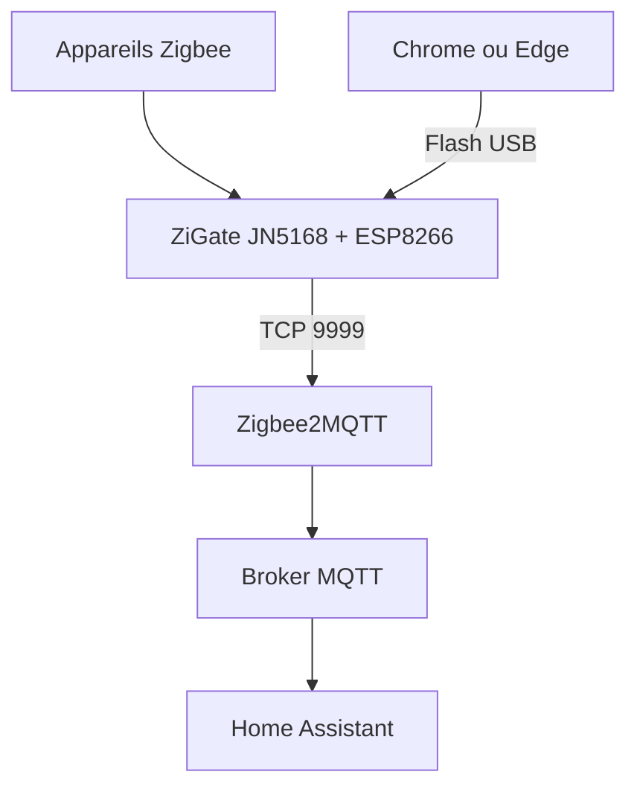

  

  <strong>Réutilise ta ZiGate Wi-Fi v1.3 dans Home Assistant.</strong>
   
  Deux firmwares, une page de flash USB et un guide Zigbee2MQTT.

  
  
  
  

> [!IMPORTANT]
> Les firmwares et les échanges série ont été vérifiés en logiciel. Le flash et l’appairage sur une ZiGate physique restent à valider.

## Installation rapide

Tu as besoin d’une **ZiGate Wi-Fi v1.3**, de son adaptateur **USB‑TTL** et d’un ordinateur avec **Chrome ou Edge**.

1. Ouvre [la page de flash](https://drslid.github.io/zigate-zigbee2mqtt-home-assistant/) et programme le module **Wi-Fi**.
2. Programme la **radio Zigbee** avec l’adaptateur USB‑TTL.
3. Remonte la ZiGate et clique sur **Lire la clé Wi-Fi en USB**. Utilise cette clé pour te connecter au réseau **ZIGATE-…**, puis renseigne le Wi-Fi 2,4 GHz de ta box.
4. Installe l’application **Zigbee2MQTT** depuis la boutique Home Assistant, puis renseigne l’adresse de la ZiGate dans son assistant.
5. Appaire un appareil dans Zigbee2MQTT et retrouve-le sous **MQTT** dans Home Assistant.

**Guides** · [Flash depuis le navigateur](https://drslid.github.io/zigate-zigbee2mqtt-home-assistant/) · [Home Assistant](#installation-dans-home-assistant) · [Pilotes USB pour Windows](https://drslid.github.io/zigate-zigbee2mqtt-home-assistant/pilotes.html) · [Flash manuel](LISEZ-MOI.md)

## Mettre à jour la ZiGate

| Module | Matériel | Connexion | Firmware |
| --- | --- | --- | --- |
| Wi‑Fi | ESP8266 avec 4 Mo de flash | Prise USB de la carte Wi‑Fi | [Wi‑Fi 1.0.0](firmwares/ZiGate-WiFi-v1.3-Z2M-ESP8266-1.0.0.bin) |
| Radio Zigbee | MS5168‑M05 avec JN5168 | Adaptateur USB‑TTL ZiGate du kit | [Radio 3.23 OPDM](firmwares/ZiGate-Radio-JN5168-v3.23-OPDM-Z2M.bin) |

1. Ouvre la page en HTTPS. Débranche la ZiGate, sépare les cartes et choisis le module à programmer.
2. Suis les instructions de mise en mode flash sur la page, puis sélectionne le port USB. La page contrôle la puce avant l’écriture et vérifie la mémoire après l’installation. Tu peux aussi sauvegarder le programme précédent depuis la page.
3. Pour partir d’un réseau Zigbee neuf, garde la carte radio sur l’USB‑TTL après le flash. Rebranche-la sans maintenir son bouton, puis utilise **Effacer l’ancien réseau Zigbee** sur la page. Cela efface les anciens appairages.
4. Remonte la ZiGate. Clique sur **Lire la clé Wi-Fi en USB** et utilise la clé affichée pour rejoindre le réseau **ZIGATE-…**. Ouvre `http://192.168.4.1/`, puis saisis le nom et le mot de passe du **Wi-Fi 2,4 GHz de ta box**. Après le redémarrage, relève l’IP attribuée par le routeur.

Le [guide complet](LISEZ-MOI.md) décrit aussi le flash avec les outils en ligne de commande. Le [pack ZIP](ZiGate-v1.3-Zigbee2MQTT-1.0.0.zip) contient les binaires, les sources et leurs empreintes. Les sauvegardes réalisées depuis la page restent sur l’ordinateur.

## Installation dans Home Assistant

### Home Assistant OS

1. Dans **Paramètres → Applications → Installer une application**, installe et démarre [Mosquitto broker](https://my.home-assistant.io/redirect/supervisor_addon/?addon=core_mosquitto) si tu n’as pas déjà de broker MQTT.
2. Dans la boutique, ouvre **⋮ → Dépôts**, ajoute `https://github.com/zigbee2mqtt/hassio-zigbee2mqtt`, puis installe l’application **Zigbee2MQTT** stable. [Ajouter le dépôt officiel](https://my.home-assistant.io/redirect/supervisor_add_addon_repository/?repository_url=https%3A%2F%2Fgithub.com%2Fzigbee2mqtt%2Fhassio-zigbee2mqtt)
3. Dans l’application, clique sur **Démarrer**, puis **Ouvrir l’interface Web**. Dans l’onglet **Serial** de l’assistant, saisis les deux valeurs ci-dessous, puis clique sur **Submit**. [Adresse TCP à copier](https://drslid.github.io/zigate-zigbee2mqtt-home-assistant/#configuration)

   | Champ | Valeur |
   | --- | --- |
   | **Adapter** | `zigate` |
   | **Port** | `tcp://192.168.1.50:9999` en remplaçant `192.168.1.50` par l’IP locale de ta ZiGate |

4. Dans **Paramètres → Appareils et services**, configure l’[intégration MQTT](https://www.home-assistant.io/integrations/mqtt/) si nécessaire. Dans Zigbee2MQTT, ouvre temporairement l’appairage et ajoute un appareil. Il doit apparaître sous **MQTT** dans Home Assistant.

Avec Mosquitto sur la même instance Home Assistant, l’application Zigbee2MQTT récupère automatiquement les paramètres du broker et active la découverte Home Assistant. Avec un broker externe, saisis son adresse et ses identifiants dans l’onglet **MQTT** de l’assistant et configure l’intégration MQTT de Home Assistant sur ce même broker.

Pour une application déjà configurée, **Configuration → Afficher les options facultatives → `force_onboarding`** permet de relancer l’assistant après un redémarrage. Désactive cette option après l’enregistrement. Si tu avais déjà renseigné `serial` dans la configuration de l’application, ces valeurs sont prioritaires. [Documentation de l’application Zigbee2MQTT](https://github.com/zigbee2mqtt/hassio-zigbee2mqtt/blob/master/zigbee2mqtt/DOCS.md#onboarding)

### Home Assistant Container

Lance [Zigbee2MQTT en conteneur](https://www.zigbee2mqtt.io/guide/installation/02_docker.html) avec son dossier de données persistant et un broker MQTT accessible. Réutilise le [fichier d’exemple](home-assistant/zigbee2mqtt.example.yaml) en remplaçant `core-mosquitto` par l’adresse ou le nom DNS du broker. Configure l’intégration MQTT de Home Assistant avec ce même broker. La ZiGate communique avec Zigbee2MQTT en TCP, donc le conteneur doit pouvoir joindre son IP sur le port 9999.

### Dépannage

- Si le flasheur bloque à l’identification de la mémoire Wi-Fi, recharge la page et réessaie avec le module Wi-Fi seul. Relève le code JEDEC affiché si l’erreur persiste.
- Si le navigateur ne parvient pas à ouvrir le port série de la radio, [vérifie le port COM et le pilote de l’adaptateur USB‑TTL](LISEZ-MOI.md#port-com-de-la-radio-sous-windows).
- Si Zigbee2MQTT échoue au démarrage, vérifie l’adresse de la ZiGate, le port `9999` et le journal à partir de `Starting zigbee-herdsman`. Un seul programme doit se connecter à la ZiGate à la fois. Déconnecte une éventuelle intégration ZHA utilisant cette passerelle.
- Si l’appareil apparaît dans Zigbee2MQTT mais pas dans Home Assistant, vérifie `homeassistant.enabled: true`, les identifiants MQTT et le broker utilisé des deux côtés.
- Le [pilote ZiGate de Zigbee2MQTT](https://www.zigbee2mqtt.io/guide/adapters/zigate.html) n’est plus maintenu. La sauvegarde native du réseau via Zigbee2MQTT n’est pas disponible pour ce modèle.

## Sources et développement

- [Sources et compilation des firmwares](sources/COMPILATION.md)
- [Notices et licences des composants](licences/)
- [Protocole de programmation JN51xx](https://www.nxp.com/docs/en/application-note/JN-AN-1003.pdf) et [esptool-js](https://github.com/espressif/esptool-js)

Le site est statique. GitHub Pages le sert depuis la racine de la branche `main`. Pour l’essayer sur ton ordinateur, lance `python3 -m http.server 8000` à la racine du dépôt et ouvre [localhost:8000](http://localhost:8000/).

Avec Node.js 22 ou plus récent, lance `node --test tests/serial.test.mjs` pour vérifier les échanges série simulés, les sauvegardes et les contrôles avant et après écriture.

## Architecture

## Licences

Les notices de la radio, du cœur ESP8266 et des bibliothèques du site sont disponibles dans [licences/](licences/).
