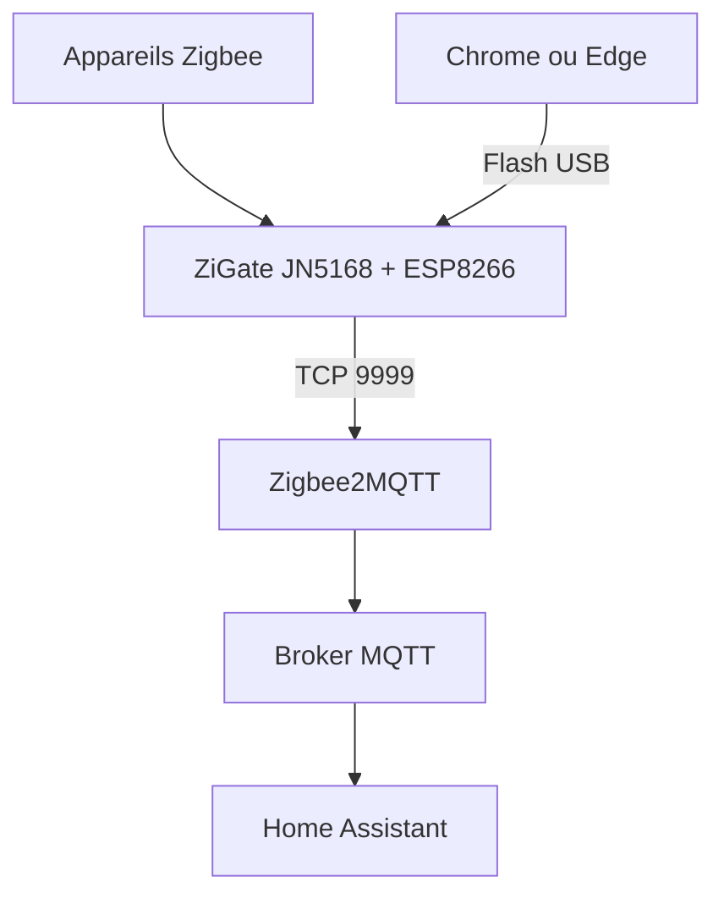

  

  <strong>Réutilise ta ZiGate Wi-Fi v1.3 dans Home Assistant.</strong>
   
  Deux firmwares, un outil de flash et de configuration Wi-Fi par USB et une application Zigbee2MQTT dédiée à la ZiGate.

  
  
  
  

> [!IMPORTANT]
> Le firmware Wi-Fi 1.1.0 a été compilé pour l’ESP8266. La configuration Wi-Fi par USB a été testée en simulation et reste à valider sur la carte physique.

## Installation rapide

Tu as besoin d’une **ZiGate Wi-Fi v1.3**, de son adaptateur **USB‑TTL** et d’un ordinateur avec **Chrome ou Edge**.

1. Installe le firmware **Wi-Fi 1.1.0**, puis saisis le Wi-Fi 2,4 GHz de ta box dans [le formulaire USB de l’étape 1](https://drslid.github.io/zigate-zigbee2mqtt-home-assistant/#wifi). La page affiche l’adresse IP du module.
2. Programme la **radio Zigbee** avec l’adaptateur USB‑TTL.
3. Remonte la ZiGate et branche-la. Elle rejoint le Wi-Fi enregistré à l’étape 1.
4. Installe **Zigbee2MQTT ZiGate** depuis la boutique Home Assistant et renseigne l’adresse IP de la passerelle dans **Configuration**.
5. Appaire un appareil dans **Zigbee2MQTT ZiGate** et retrouve-le sous **MQTT** dans Home Assistant.

**Guides** · [Flash depuis le navigateur](https://drslid.github.io/zigate-zigbee2mqtt-home-assistant/) · [Home Assistant](#installation-dans-home-assistant) · [Pilotes USB pour Windows](https://drslid.github.io/zigate-zigbee2mqtt-home-assistant/pilotes.html) · [Flash manuel](LISEZ-MOI.md)

## Mettre à jour la ZiGate

| Module | Matériel | Connexion | Firmware |
| --- | --- | --- | --- |
| Wi‑Fi | ESP8266 avec 4 Mo de flash | Prise USB de la carte Wi‑Fi | [Wi‑Fi 1.1.0](firmwares/ZiGate-WiFi-v1.3-Z2M-ESP8266-1.1.0.bin) |
| Radio Zigbee | MS5168‑M05 avec JN5168 | Adaptateur USB‑TTL ZiGate du kit | [Radio 3.23 OPDM](firmwares/ZiGate-Radio-JN5168-v3.23-OPDM-Z2M.bin) |

1. Ouvre la page en HTTPS. Débranche la ZiGate, sépare les cartes et choisis le module à programmer.
2. Suis les instructions de mise en mode flash sur la page, puis sélectionne le port USB. La page contrôle la puce avant l’écriture et vérifie la mémoire après l’installation. Tu peux aussi sauvegarder le programme précédent depuis la page.
3. Pour partir d’un réseau Zigbee neuf, garde la carte radio sur l’USB‑TTL après le flash. Rebranche-la sans maintenir son bouton, puis utilise **Effacer l’ancien réseau Zigbee** sur la page. Cela efface les anciens appairages.
4. Une fois les deux cartes préparées, débranche-les, remonte la ZiGate et branche-la bouton relâché.

Le [guide complet](LISEZ-MOI.md) décrit aussi le flash avec les outils en ligne de commande. Le [pack ZIP](ZiGate-v1.3-Zigbee2MQTT-1.1.0.zip) contient les binaires, les sources et leurs empreintes. Les sauvegardes réalisées depuis la page restent sur l’ordinateur.

### Changer de Wi-Fi

Débranche la ZiGate, sépare le module Wi-Fi et rebranche ce module seul avec le bouton relâché. Une fois la carte alimentée, maintiens son bouton 2 secondes, puis relâche-le. Saisis le nouveau réseau dans [le formulaire USB](https://drslid.github.io/zigate-zigbee2mqtt-home-assistant/#wifi). La carte enregistre les identifiants après avoir obtenu une adresse IP. Si l’adresse change, mets-la à jour dans **Zigbee2MQTT ZiGate → Configuration** et redémarre cette application.

La méthode via [le point d’accès de la ZiGate](https://drslid.github.io/zigate-zigbee2mqtt-home-assistant/#wifi-ap) reste disponible avec les firmwares Wi-Fi 1.0.0 et 1.1.0.

## Installation dans Home Assistant

### Home Assistant OS

**Zigbee2MQTT ZiGate** est une application indépendante de l’application Zigbee2MQTT officielle. Elle lance Zigbee2MQTT 2.14.3 avec son propre dossier de données, sa propre page dans la barre latérale et le préfixe MQTT `zigbee2mqtt_zigate`. Tu peux l’installer à côté de ton instance actuelle.

1. Dans **Paramètres → Applications → Installer une application → ⋮ → Dépôts**, ajoute `https://github.com/drslid/zigate-zigbee2mqtt-home-assistant`. [Ajouter le dépôt ZiGate](https://my.home-assistant.io/redirect/supervisor_add_addon_repository/?repository_url=https%3A%2F%2Fgithub.com%2Fdrslid%2Fzigate-zigbee2mqtt-home-assistant)
2. Installe **Zigbee2MQTT ZiGate**. L’image est assemblée sur ton Home Assistant à partir de l’image officielle Zigbee2MQTT. L’application est disponible sur `amd64` et `aarch64`.
3. Ouvre **Configuration**, saisis l’adresse IPv4 locale de la ZiGate, choisis un canal différent de celui de ton réseau Zigbee actuel, puis enregistre. [Adresse IP à copier](https://drslid.github.io/zigate-zigbee2mqtt-home-assistant/#configuration)
4. Dans **Informations**, clique sur **Démarrer → Ouvrir l’interface Web**. Active **Afficher dans la barre latérale** pour retrouver la page **Zigbee2MQTT ZiGate**.
5. Active temporairement l’appairage dans cette page. Le nouvel appareil doit apparaître sous **MQTT** dans Home Assistant.

L’application récupère automatiquement les paramètres de **Mosquitto** s’il est installé dans Home Assistant. Si ton instance actuelle utilise un broker externe, renseigne le même broker et ses identifiants dans **Configuration → Broker MQTT externe**. Pour une première installation, installe [Mosquitto broker](https://my.home-assistant.io/redirect/supervisor_addon/?addon=core_mosquitto) et ajoute l’[intégration MQTT](https://www.home-assistant.io/integrations/mqtt/) si nécessaire.

[Documentation de l’application ZiGate](zigbee2mqtt_zigate/DOCS.md)

### Home Assistant Container

Lance une deuxième instance de [Zigbee2MQTT en conteneur](https://www.zigbee2mqtt.io/guide/installation/02_docker.html) avec son propre dossier de données et un broker MQTT accessible. Utilise le préfixe `zigbee2mqtt_zigate`, choisis un canal Zigbee distinct et attribue un port hôte différent à l’interface Web. Dans le [fichier d’exemple](home-assistant/zigbee2mqtt.example.yaml), renseigne ton broker et l’adresse IP locale de la ZiGate. Le conteneur doit pouvoir joindre la passerelle sur le port 9999.

### Dépannage

- Si le flasheur bloque à l’identification de la mémoire Wi-Fi, recharge la page et réessaie avec le module Wi-Fi seul. Relève le code JEDEC affiché si l’erreur persiste.
- Si le navigateur ne parvient pas à ouvrir le port série de la radio, [vérifie le port COM et le pilote de l’adaptateur USB‑TTL](LISEZ-MOI.md#port-com-de-la-radio-sous-windows).
- Si Zigbee2MQTT échoue au démarrage, vérifie l’adresse de la ZiGate, le port `9999` et le journal à partir de `Starting zigbee-herdsman`. Un seul programme doit se connecter à la ZiGate à la fois. Déconnecte une éventuelle intégration ZHA utilisant cette passerelle.
- Si l’appareil apparaît dans Zigbee2MQTT mais pas dans Home Assistant, vérifie `homeassistant.enabled: true`, les identifiants MQTT et le broker utilisé des deux côtés.
- Le [pilote ZiGate de Zigbee2MQTT](https://www.zigbee2mqtt.io/guide/adapters/zigate.html) n’est plus maintenu. La sauvegarde native du réseau via Zigbee2MQTT n’est pas disponible pour ce modèle.

## Sources et développement

- [Sources et compilation des firmwares](sources/COMPILATION.md)
- [Notices et licences des composants](licences/)
- [Protocole de programmation JN51xx](https://www.nxp.com/docs/en/application-note/JN-AN-1003.pdf) et [esptool-js](https://github.com/espressif/esptool-js)

Le site est statique. GitHub Pages le sert depuis la racine de la branche `main`. Pour l’essayer sur ton ordinateur, lance `python3 -m http.server 8000` à la racine du dépôt et ouvre [localhost:8000](http://localhost:8000/).

Avec Node.js 22 ou plus récent, lance `node --test tests/serial.test.mjs` pour vérifier les échanges série simulés, les sauvegardes et les contrôles avant et après écriture.

## Architecture

## Licences

Les notices de la radio, du cœur ESP8266 et des bibliothèques du site sont disponibles dans [licences/](licences/).
